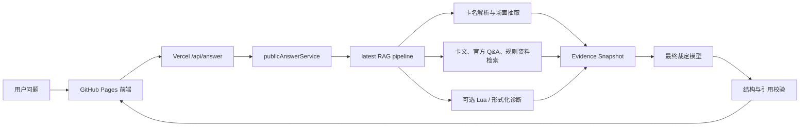
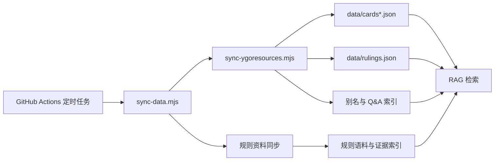

# 当前架构

本文只描述当前生产实现。历史实验、已删除的规则引擎原型和冻结回答版本不属于生产调用链。

## 请求链路

## 入口与职责

- `index.html`、`src/app.js`、`src/styles.css`：静态网页与 API 客户端。
- `api/answer.js`：Vercel 公开回答入口，只负责 HTTP、CORS 和中断传播。
- `backend/server.mjs`：本地开发服务器；公开回答同样调用共享服务。
- `backend/publicAnswerService.mjs`：统一 Vercel 与本地入口的请求限制、模型配置、版本选择、审计、耗时记录和错误映射。
- `backend/rulingVersionRegistry.mjs`：当前只允许 `latest`，并转发到 `backend/ragRulingPipeline.mjs`。
- `backend/ragRulingPipeline.mjs`：组织卡名抽取、证据检索、提示词、模型调用及最终结果校验。
- `backend/ragEvidenceRetriever.mjs`、`backend/officialQaMatcher.mjs`：构建并评估证据，区分直接适用、相关但有条件以及前提不匹配的资料。
- `backend/ragRulingPrompt.mjs`、`backend/ragModelClient.mjs`：构建最终模型输入并调用服务端配置的模型。

浏览器不会接收模型 API Key，也不能通过请求体任意选择未公开的供应商或模型。管理模型实验室使用独立的认证、路由和存储，不进入公开回答入口。

## 数据链路

`backend/dataIndex.mjs` 是同步链路使用的索引构建工具，不是旧回答引擎。同步脚本只标准化外部资料和生成索引，不写入具体题目的裁定答案。

## 证据边界

- 卡片文本、官方 Q&A、规则资料和社区资料保留各自来源与权威等级。
- 相似 Q&A 必须核对所问阶段、参与卡片和场景前提；前提不一致时只能作为条件对照。
- Lua 与形式化内核结果属于辅助诊断；缺失、超时或无法验证时不得伪装成官方真值。
- 最终结构校验负责 JSON、引用和证据绑定，不应凭启发式规则覆盖模型的实体裁定。

## 证据不足时的补充检索

- 仅当 `EVIDENCE_SUPPLEMENT_ENABLED=true` 时，最终提示才要求模型在正文最后单独一行写 `证据状态：充分` 或 `证据状态：不足｜缺少：<缺的规则/裁定>`；开关关闭时最终提示与引入该协议前逐字节相同（测试用 483b000 的 sha256 金值核对）。`backend/evidenceStatusProtocol.mjs` 始终把这一行读成 `evidenceStatus`（sufficient / insufficient / unknown）与 `evidenceGap` 字段并从展示正文删除，读不出即 unknown，不触发任何动作。
- `EVIDENCE_SUPPLEMENT_ENABLED=true`（代码默认关闭，`vercel.json` 开启）时，首答为 insufficient 且写明缺口、首轮使用 bounded Luna 选证，`backend/evidenceSupplementRound.mjs` 补一轮且只补一次：以缺口为检索范围规划和召回，并复用首轮候选。首轮读过但未选的原文可以再次入窗；已交付的原文按同一版本的身份重新读取，放入 `previously_delivered` 组，与本轮候选一起计入既有阅读窗口和调用费用。Luna 从新旧原文中重新选择完整证据包，仍需使用的旧证据必须重新选入；旧包满不再阻止补查，也不再固定保留旧包后由程序裁掉新增证据。超出最终包上限则保留首答，不截断原文。
- 证据充分不要求同卡组合的直接 FAQ：完整卡文、适用通则或核对条件后的相关裁定可以支持推导；真实缺少决定性依据时仍报告具体缺口。题面缺少事实时按条件分支说明，不当成可通过检索补齐的资料缺口。程序不判断裁定是否正确，也不强制把正文换成“无法判断”。
- 时间保护：调用已用时间 + `EVIDENCE_SUPPLEMENT_ESTIMATED_ROUND_MS`（默认 110 s）超过 280 s（300 s 函数上限减去与引擎复现等待相同的 20 s 余量）就跳过并记 `skipped_time_budget`；单请求（外部 API/Bot）从公开请求开始计时，网页 finalize 从其自身请求开始计时；补轮在 280 s 处被硬性中止。
- 规划、检索、选证或第二次最终调用任何一步失败（或没有新条目）都保留首轮答案；补充轮期间请求被取消也只中止补充轮、保留首轮答案（记 `cancelled_during_supplement`），只有首轮本身被取消才报错；网页在补轮期间收到 `evidence_supplement` 阶段事件并显示“证据不足，正在补充检索…”。答案末尾区分补查失败、未补入资料、时间不足未启动；采用第二答但其仍报告具体缺口时展示该缺口。`debug.evidenceSupplement` 记录状态、缺口、召回/入窗/选中/新增/移除数量、耗时与费用。
- 补充轮不重复调用目录选节；首轮目录仍按原开关配置，默认不启用。阅读窗口、最终包、每日账本和已配置的单题费用上限均不提高；单题有限额度先扣除首轮已花费用，所有补查及重答费用继续计入既有账本。触发补查时会新增调用，不能据此声称每题费用与首轮相同。110 s 只是可配置的时间估计，未经过本轮真实题目验证。

## 部署

- GitHub Pages 发布静态前端和轻量卡片快照。
- Vercel 承载公开回答与管理 API。
- `.github/workflows/sync-data.yml` 定时更新资料；`.github/workflows/deploy-pages.yml` 在发布前执行源码检查和串行测试。
