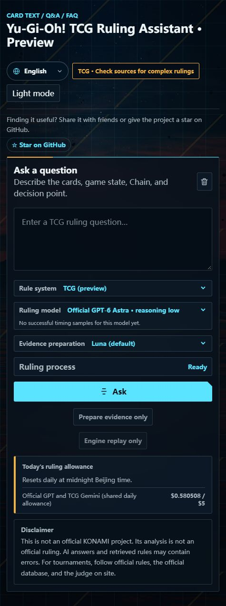

# Yu-Gi-Oh! TCG Ruling Assistant — Public Preview

[Try the TCG demo](https://tcg-ruling-assistant.vercel.app/) · [Use the OCG demo](https://coldiceh.github.io/ocg-ruling-assistant/) · [Report a mistake](https://github.com/coldiceh/ocg-ruling-assistant/issues)

Describe the game state and the interaction you want to check. The assistant helps identify the cards, gather relevant evidence, and explain its answer with source references.

The TCG demo defaults to English. Chinese and Japanese are available in the language menu, and your choice is remembered.

## Try a complete question

For example: “I control a face-up Warrior monster, and Rivalry of Warlords is active. Can I activate Monster Reborn targeting a Spellcaster monster in my GY?”

Include the full card names, relevant effects, game state, and sequence of actions. Check the identified cards and read the cited sources before relying on the analysis.

## What to expect

- TCG and OCG have separate demos.
- When an answer uses an OCG precedent, it is explicitly labeled so you can distinguish it from TCG evidence.
- This is an early public preview. Answers may be incomplete or incorrect, and there is no published broad TCG accuracy claim. The README's 50-question results belong to OCG.
- The hosted preview has a shared daily usage limit. Available models are shown in the demo.
- This is an independent project, not an official KONAMI service or a replacement for an event judge.

## Help improve it

Reproducible mistakes are especially useful. [Open an issue](https://github.com/coldiceh/ocg-ruling-assistant/issues) with your full question, the assistant's answer, and any relevant source. You can also discuss your experience in [GitHub Discussions](https://github.com/coldiceh/ocg-ruling-assistant/discussions).

If the tool helps you, share the demo with another player or star the repository to help others discover it.
